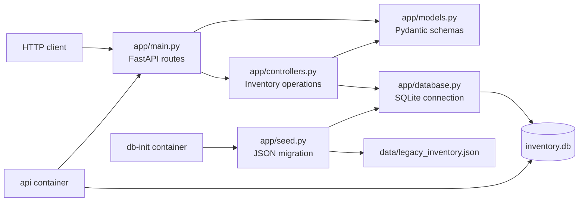

# Lab 4 Reverse-Engineering Notes

## Codebases examined

- The Lab 2 student application separates records (`students.py`), helper
  calculations (`utils/helpers.py`), and console interaction (`app.py`). Its
  main dependency flow is one-way, but data access is tied to an in-memory
  module-level list and the console entry point combines presentation with
  application orchestration.
- The Lab 3 inventory project separates sample records, the `InventoryItem`
  dataclass, calculation helpers, and the console entry point. Its records and
  calculations still run entirely in process, so there is no persistence or
  external API for another application to consume.

## Refactored responsibilities

- `app/models.py` validates API input and defines response schemas.
- `app/database.py` owns SQLite connection and schema creation.
- `app/controllers.py` performs parameterized database operations.
- `app/main.py` maps HTTP routes to controller operations.
- `app/seed.py` migrates the Lab 3 JSON inventory into SQLite.

## Coupling and code-smell observations

The original inventory demo depended directly on a Python list, which couples
the data source to the process lifetime and makes updates disappear when the
program exits. Direct console printing also couples presentation to
calculation. Lab 4 places persistence behind controller functions, validates
input at the API boundary, and keeps route handlers thin. The JSON seed file is
an explicit migration source; a named Docker volume retains the resulting
SQLite database across container restarts.

## Verification

The API tests cover the JSON-to-SQLite seed, read and create operations,
invalid input, duplicate names, and missing records. The Compose deployment
uses a one-shot database initializer and the API as separate services sharing
the same SQLite volume.
